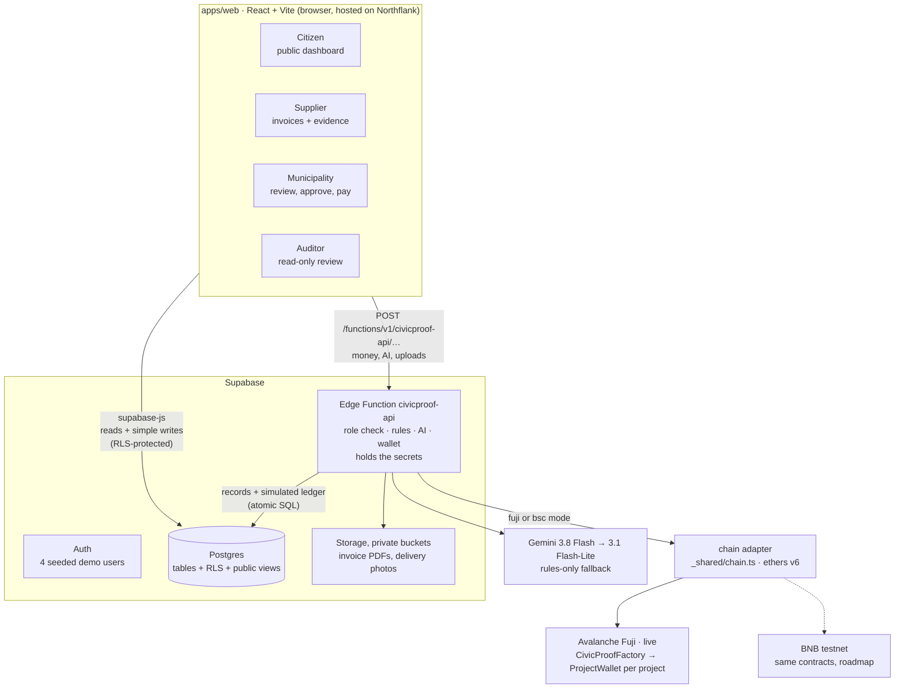
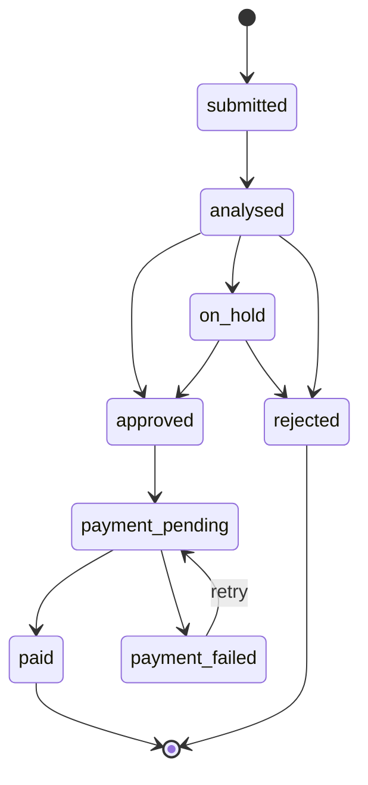

# CivicProof

> **Follow the money. Prove the service.**

[](https://github.com/Wityd/civic_proof/actions/workflows/ci.yml)

CivicProof is a public-spending accountability platform built for the **BACISS 2026 hackathon** (Blockchain, AI and Cloud Innovation Startup School). It ring-fences each municipal project's budget in its own wallet contract on a blockchain. AI screens every supplier invoice before any money leaves, an authorised human decides, and every payment, hold and rejection is visible to citizens.

> ⚠️ **Simulated funds only.** Every project, supplier, price and amount in this repository is fictional. **DemoZAR (dZAR)** is a labelled test token on public **testnets** (Avalanche Fuji, BNB Smart Chain testnet). It is not real, backed or redeemable currency.

## 🟢 Live now

| | |
| --- | --- |
| **Web app** | [p01--civic-proof--8f4krl9y68m6.code.run](https://p01--civic-proof--8f4krl9y68m6.code.run/) (Northflank) |
| **Chain** | Avalanche Fuji testnet: all three contracts **deployed and source-verified** on Snowtrace |
| **CP001 project wallet** | [`0xAdA383A5…AC83D4D`](https://testnet.snowtrace.io/address/0xAdA383A5DF097C3Ef1F23ee2d4db670A8Ac83D4D): R2,000,000.00 funded, **R1,881,600.00** after the first payment |
| **First real payment** | Invoice BB-001, R118,400.00 to Blue Basin Tanks: [submitted](https://testnet.snowtrace.io/tx/0x7165824c054bbaca20dea464f8bbf3235a1e27a82f8dc54cce01d05c47474d65) → [approved](https://testnet.snowtrace.io/tx/0xa893cee33b52efefc830e44a9033fc46a564862d00690c591649952ade563d0e) → [released](https://testnet.snowtrace.io/tx/0xaeaa304b9a3e0b1ab48260c6a5bf961782bd0fad7d025b7f9e7837588511ee19) |
| **AI** | Gemini explanations with guardrails, on top of deterministic rules ([details](#ai-expenditure-review)) |

---

## Contents

- [Live now](#-live-now)
- [The problem](#the-problem)
- [What CivicProof does](#what-civicproof-does)
- [The demo](#the-demo)
- [Architecture](#architecture)
- [Tech stack](#tech-stack)
- [Repository layout](#repository-layout)
- [Getting started](#getting-started)
- [Configuration](#configuration)
- [Operations: who can do what](#operations-who-can-do-what)
- [Shared rules](#shared-rules)
- [AI expenditure review](#ai-expenditure-review)
- [Smart contracts](#smart-contracts)
- [Wallet service](#wallet-service)
- [Demo data](#demo-data)
- [Team](#team)
- [Build status](#build-status)
- [Git workflow](#git-workflow)
- [Risks and fallbacks](#risks-and-fallbacks)
- [Scope and roadmap](#scope-and-roadmap)

---

## The problem

Municipal infrastructure money often disappears between the budget and the community. Invoices get inflated, suppliers appear weeks before winning work, purchases don't match the project's purpose, and paid-for services are never delivered. By the time an audit finds it, the money is gone.

Citizens can't see where the money went. Officials have no fast, consistent way to check an invoice before it is paid.

## What CivicProof does

| Module | What it gives you |
| --- | --- |
| **Ring-fenced project wallets** | Every project gets **its own wallet contract** with its own address on the explorer. Money only leaves through an approved, recorded release. |
| **AI expenditure review** | The AI reads each invoice PDF and code checks it against what was submitted, reference prices, the project's permitted purposes, the budget and the supplier registry, then explained in plain language by Gemini, which can also spot items that don't fit their declared category. |
| **Human-in-the-loop approval** | **AI recommends; authorised humans decide.** Approving against an AI flag needs a written reason, which is recorded. |
| **Public transparency dashboard** | Citizens see budget, spent, balance, every payment with its transaction hash, and every held or rejected invoice, with personal data redacted. |
| **Delivery verification** | Milestones, photo evidence with duplicate detection, community confirmation and official verification. Delivery-dependent payments stay locked on-chain until the milestone is verified. |

### Core principles

1. **Every disbursement passes through the project wallet.** There is no side door.
2. **Rules decide, AI explains.** Flags, amounts and the recommendation come from deterministic code. The LLM writes the explanation and can only make the outcome *more* cautious, never less. We never label a supplier fraudulent on AI output alone.
3. **The chain proves integrity, not truth.** A document hash anchored on-chain proves the evidence hasn't changed since submission. It doesn't prove the evidence was true. That's why humans review it.
4. **Community confirmation is evidence, not authorisation.** Citizens can confirm delivery, but only an authorised official can release money.
5. **Secrets never reach the browser.** Signing keys and AI keys live only on the Supabase server side (Edge Function secrets).

---

## The demo

One fictional project, four invoices, one money trail that never breaks:

```
R2,000,000 project ──► invoices ──► AI flags ──► human decision ──► on-chain payment ──► public dashboard
```

1. **Citizen view.** *CP001 Kgotso Valley Water Access* shows R2,000,000.00 allocated, nothing spent, and its own wallet address on Snowtrace.
2. **Fair invoice.** 8 water tanks, no flags → approve → execute → *pending → confirmed* with an explorer link.
3. **Inflated invoice.** 20 pipes at R12,000.00 against a R5,200.00 benchmark gives **R136,000.00 potential excess**, and the supplier is only 21 days old. **Hold**: the money stays in the wallet.
4. **Wrong purpose.** A R785,000.00 double-cab bakkie on a water project → `PURPOSE_MISMATCH` → **rejected**, recorded on-chain.
5. **Prove the service.** The installation invoice is approved, but **the contract refuses to pay** until milestone M1 is verified. A re-uploaded photo is flagged `DUPLICATE_EVIDENCE`. After community confirmations and official verification, the payment goes through.
6. **Close.** The balance is **R1,817,600.00**, every payment has a hash, and held and rejected invoices are publicly visible.

---

## Architecture

**No custom API server.** The React app talks to **Supabase** directly: Auth for sign-in, the Data API (under Row Level Security) for reads and simple writes, and one **Edge Function, `civicproof-api`**, for every sensitive action. That function verifies the caller, runs the rules, moves the money and holds the secrets, so keys never reach the browser.



| Path | Used for | Protected by |
| --- | --- | --- |
| **Browser → Postgres** (supabase-js) | Own profile, a supplier's own invoices, citizen concerns, community confirmations, `get_public_dashboard` | Row Level Security per role; the public dashboard RPC returns redacted data only |
| **Browser → `civicproof-api`** (Edge Function) | Create project and milestones, submit invoice (PDF upload), analyse, approve / hold / reject, execute payment, verify milestone, upload evidence | The function verifies the caller's session and role, then uses the service-role key and secrets |
| **Storage** | Invoice PDFs and delivery photos | Buckets are private. Files are uploaded **through** the Edge Function and read with short-lived signed URLs |

Switching between the simulated ledger and a chain is **one setting** (`wallet_mode` in the server-only `private.runtime_config` table); switching the AI to rules-only is `AI_MODE`. No code changes.

### Where data lives

| On-chain (authority for money) | Supabase (application data) |
| --- | --- |
| Each project's wallet, allocation and balance | Project descriptions, users and roles, `project_wallets` (address per chain) |
| Payment amount and supplier address | Supplier details, invoices, line items |
| Invoice document hash, approvals, rejections | AI findings, reference prices, documents |
| Milestone registration and verification | Delivery photos, community confirmations, concerns |
| Every release, exactly once | The `transactions` ledger (synced from chain results) |

---

## Tech stack

| Layer | Choice |
| --- | --- |
| Frontend | React + Vite + TypeScript, Tailwind, React Router, TanStack Query, `@supabase/supabase-js` |
| Backend | **Supabase**: Auth, Postgres with RLS and RPCs, private Storage, and one **Edge Function** router (`civicproof-api`, Deno) for privileged operations |
| AI | Gemini 3.8 Flash, falling back to 3.1 Flash-Lite (JSON output, low thinking), with `AI_MODE=rules` as the full fallback |
| Contracts | Solidity 0.8.24, OpenZeppelin 5, Hardhat 2, ethers v6 |
| Chains | **Avalanche Fuji** (chain 43113), live; **BNB Smart Chain testnet** (chain 97), same contracts, deploy-ready |
| Wallet | `packages/wallet`: one `WalletService` interface with simulated and chain implementations; the Edge Function runs its Deno port, `_shared/chain.ts` |
| Hosting | Web app on **Northflank** (Docker, nginx); everything else on Supabase |

---

## Repository layout

**Owning a folder means you merge into it; anyone else opens a PR.**

```
civic_proof/
├── apps/
│   └── web/                  P1  React app (pages/delivery/* → P5, components/ai/* → P4)
├── supabase/                 P2  schema.sql, seed.sql, migrations/, verify.sql, tests/
│   ├── functions/
│   │   ├── civicproof-api/   P2  the Edge Function router
│   │   └── _shared/          rules engine (P2), chain adapter and AI layer (P3)
│   ├── deployments/          P3  SQL that records the live Fuji wallet and ledger
│   └── tools/ai-try.mts      P3  try the Gemini explanations locally with your own key
├── contracts/                P3  Hardhat: DemoZAR, CivicProofFactory, ProjectWallet + tests + deploy scripts
│   └── deployments/          P3  public addresses per chain (fuji.json, bscTestnet.json)
├── packages/
│   ├── wallet/               P3  WalletService: simulated (SQL) + chain (Fuji/BNB), shared test suite
│   └── shared/               P2  shared types; abi/ is written by P3's export-abi script
├── deploy/                   P3  Northflank: web Dockerfile, nginx config, deploy guide
├── docs/                     P2  backend reference, Supabase setup, chain mode and demo-day runbook
└── scripts/                  P2  Supabase setup and verification helpers
```

---

## Getting started

### Prerequisites

- Node.js 20 or 22 (LTS). Hardhat 2 is not tested on newer versions.
- Access to the team's Supabase project (URL and anon key from the team channel)
- For contracts: a **testnet-only** deployer key with test AVAX (and test BNB for BNB testnet)

### Frontend (P1)

```bash
cd apps/web && npm ci && npm run dev
```

Unit tests: `npm test` (money formatting, flags, ledger and the follow-the-money timeline). With `VITE_USE_MOCKS=true` the app runs on local mock data and needs no Supabase at all (`VITE_MOCK_SCENARIO=start` begins from an untouched project). The hosted build is described in [`deploy/README.md`](deploy/README.md).

### Supabase (P2)

The team's Supabase project is already provisioned and verified by P2. To rebuild it: apply `supabase/schema.sql`, then the files in `supabase/migrations/`, then `supabase/seed.sql`, and deploy the `civicproof-api` Edge Function. `supabase/verify.sql` checks the result. Step-by-step instructions are in [`docs/SUPABASE-SETUP.md`](docs/SUPABASE-SETUP.md), and the frontend integration guide is [`docs/FRONTEND-CONTRACT.md`](docs/FRONTEND-CONTRACT.md).

Deploying the Edge Function after a change:

```bash
npx supabase functions deploy civicproof-api --project-ref <project-ref>
```

Its tests (rules, AI guardrails, model fallback) run with `deno test supabase/functions/_shared/`.

### AI (try it locally)

Put `GEMINI_API_KEY=` in the git-ignored `contracts/.env`, then from the repo root:

```bash
node supabase/tools/ai-try.mts
```

It runs the real AI code on the demo invoices and prints each explanation and final recommendation. Nothing is stored. On Node 22, add `--experimental-strip-types`.

### Contracts (P3)

```bash
cd contracts && npm ci && npm test
```

That runs 43 tests. Deploying (needs `contracts/.env`, see [Configuration](#configuration)):

```bash
npm run deploy:fuji && npm run setup:demo:fuji && npm run export-abi
```

Replace `fuji` with `bsc` for BNB testnet. `setup:demo` creates CP001's wallet, funds it with R2,000,000.00 dZAR and registers M1. It is safe to re-run.

### Wallet service (P3)

```bash
cd packages/wallet && npm ci && npm test
```

That runs 34 tests. The chain suite needs the contracts compiled first (`npm test` in `contracts/`).

---

## Configuration

> 🔐 **Never commit `.env` files or keys.** Only `.env.example` templates are committed. Share real values privately.

**Frontend: `apps/web/.env`** (public values only; these ship to the browser)

```dotenv
VITE_SUPABASE_URL=https://<project>.supabase.co
VITE_SUPABASE_ANON_KEY=          # publishable/anon key only
VITE_API_URL=https://<project>.supabase.co/functions/v1/civicproof-api
VITE_USE_MOCKS=true          # false = the live Supabase backend
```

`civicproof-api` keeps the same route paths as the original API plan (`/invoices/:id/approve`, `/payments/:id/execute`, …), so the frontend calls it like a REST API, adding the signed-in user's session token.

**Edge Function secrets** (set with `supabase secrets set`, never in the frontend)

```dotenv
# Supabase injects SUPABASE_URL, SUPABASE_ANON_KEY and SUPABASE_SERVICE_ROLE_KEY automatically
GEMINI_API_KEY=              # from Google AI Studio
AI_MODE=llm                  # llm | rules (unset = rules)
GEMINI_MODEL=                # optional comma list; default gemini-3.8-flash,gemini-3.1-flash-lite
DEPLOYER_PRIVATE_KEY=        # testnet-only; holds the contract roles
FUJI_RPC_URL=                # optional; default https://api.avax-test.network/ext/bc/C/rpc
BSC_TESTNET_RPC_URL=         # optional; default https://data-seed-prebsc-1-s1.bnbchain.org:8545
```

The chain itself is chosen by `wallet_mode` in the server-only `private.runtime_config` table (`simulated`, `fuji` or `bsc`), not by a secret. Each project's wallet address is stored in `project_wallets`. The public contract addresses are also in `packages/shared/abi/addresses.json`, written by `npm run export-abi`.

**Contracts: `contracts/.env`** (copy from `contracts/.env.example`)

```dotenv
DEPLOYER_PRIVATE_KEY=0x…     # 0x + 64 hex characters, no spaces, no quotes
ETHERSCAN_API_KEY=           # needed for BscScan verification; Snowtrace accepts any value
PROJECT_UUID=10000000-0000-4000-8000-000000000001
MILESTONE_M1_UUID=30000000-0000-4000-8000-000000000001
PROJECT_ALLOCATION_CENTS=200000000
```

---

## Operations: who can do what

The browser never moves money itself. Simple, low-risk writes go straight to Postgres under RLS. Everything that touches the wallet, the AI, files or a secret goes through `civicproof-api`, which checks the caller's role first. The routes below are relative to `/functions/v1/civicproof-api`.

| Operation | Who | How | Wallet call |
| --- | --- | --- | --- |
| View projects, balances, ledger, held/rejected invoices | Anyone | `rpc('get_public_dashboard')` or `GET /projects…` (redacted) | `getBalance` (synced) |
| Create project | Municipality | `POST /projects` | `createProject` → `fundProject` |
| Create and register milestone | Municipality | `POST /projects/:id/milestones`, `POST /milestones/:id/register` | `registerMilestone` |
| Submit invoice (PDF + line items) | Supplier | `POST /invoices` (multipart; server checks the file and computes SHA-256) | `submitPaymentRequest` |
| View own invoices | Supplier | Postgres: RLS (own rows) | n/a |
| Run AI analysis | Municipality | `POST /invoices/:id/analyse` | n/a |
| Approve (reason required if flagged; not the submitter) | Municipality | `POST /invoices/:id/approve` | `approvePayment` |
| Hold (reason required) | Municipality | `POST /invoices/:id/hold` | **none**: hold is off-chain |
| Reject (reason required) | Municipality | `POST /invoices/:id/reject` | `rejectPayment` |
| Execute payment (idempotent) | Municipality | `POST /payments/:invoiceId/execute` | `releasePayment` |
| Upload delivery evidence | Supplier, citizen | `POST /milestones/:id/evidence` (duplicate-photo hash check) | n/a |
| Community confirmation | Citizen | Postgres: RLS insert | n/a (evidence, not authorisation) |
| Official verification | Municipality, auditor | `POST /milestones/:id/verify` | `verifyMilestone` |
| Raise concern | Citizen | Postgres: RLS insert, or `POST /projects/:id/concerns` | n/a |
| Respond to a concern | Municipality | `POST /concerns/:id/respond` | n/a |
| Review everything read-only | Auditor | Postgres: RLS read policies | n/a |

> The full, current route list is in [`docs/BACKEND.md`](docs/BACKEND.md) (owned by P2).

---

## Shared rules

### Conventions

- **Money is integer cents everywhere:** `bigint` in Postgres, `bigint` in TypeScript, fields ending `_cents` in JSON. On-chain, dZAR has 2 decimals, so 1 token unit = 1 cent. Never use floats for money.
- **IDs are UUIDs.** On-chain ids are `keccak256(utf8(uuid))`, so the same UUID gives the same id on every chain.
- **Document hashes** are SHA-256, 64 lowercase hex characters, computed on the server.
- **Public reads never return** supplier contact details, user emails or raw AI prompts.
- **Invoice numbers are deliberately not unique** in the database, so the rules engine can flag duplicates.

### Invoice state machine



Any other transition is refused. A user can't approve an invoice they submitted. A payment is only marked `paid` after the wallet confirms it; a timeout stays `payment_pending` and is reconciled later.

---

## AI expenditure review

```
Submit ──────► Read ───────────► Retrieve ──────► Validate ──────► Explain ──────► Human review
PDF + line     Gemini reads     reference        rules compare   Gemini writes   approve /
items, SHA-256 the PDF into     prices, registry PDF ↔ form ↔    2–4 plain       hold /
anchored       fixed fields     budget           registry, flags sentences       reject
```

**Rules decide, AI explains.** The deterministic rules (`supabase/functions/_shared/rules.ts`) produce every flag, every amount and the recommendation. They are repeatable and tested. Gemini (`_shared/ai.ts`) receives **only the rules' results** and turns them into a short explanation an official can act on.

**Guardrails.** Each one is a unit test:

- **No invented numbers.** Every figure in the reply must already appear in the rule results; otherwise the whole reply is discarded.
- **No accusations.** Words like *fraud* or *corrupt* get the reply discarded. We describe facts and say what to verify.
- **Only more caution, never less.** The AI can't remove a flag, change an amount, approve or reject. It *can* point out an item whose description doesn't fit its declared category, which adds `AI_CATEGORY_CONCERN` and turns an `APPROVE` into `HOLD_FOR_REVIEW`.
- **Never in the way.** Gemini 3.8 Flash answers first; if it is overloaded, retired or slow (7 s per model), 3.1 Flash-Lite answers; after 15 s in total, or on any bad reply, the rules' own explanation is used. The analysis never fails because of the AI.
- **Keys stay on the server.** The Gemini key is an Edge Function secret and is sent in a header, never a URL.
- **`AI_MODE=rules`** switches the LLM off completely, with template explanations.

**The AI reads the invoice.** Gemini reads the attached PDF into fixed fields (supplier, registration number, invoice number, lines, total). Plain code, not the AI, compares them with what the supplier typed and with the supplier registry. A supplier who types the fair R5,200.00 benchmark price into the form but attaches an invoice charging R12,000.00 is caught: `DOCUMENT_MISMATCH`, held for review. The PDF is treated as untrusted. Instructions written inside it are ignored, and only short, cleaned values reach the explanation step. If it can't be read, an info note asks the reviewer to compare it by hand. Try it locally: `node supabase/tools/pdf-try.mts PD-0147.pdf`.

**Possible supplier relationships.** Plain code compares the invoicing supplier with every other registered supplier. Two "different" companies that share a payout wallet, contact email or phone number are flagged `SUPPLIER_LINKED`, naming any invoices the other one has on the same project. The reviewer is asked to check that they are independent; the check never calls anything fraud. Demo data: `supabase/deployments/demo_linked_supplier.sql`.

**What fixed rules can't see.** A R785,000.00 bakkie filed under *pipes* (a permitted category) passes every rule. Gemini notices that the description doesn't match the category, and the invoice is held for review instead of approved.

| Flag | Severity | Fires when |
| --- | --- | --- |
| `PURPOSE_MISMATCH` | high | A line's category isn't in the project's `permitted_categories` |
| `PRICE_ABOVE_BENCHMARK` | high | Unit price is more than **15%** above the reference price |
| `DUPLICATE_INVOICE` | high | Same supplier and invoice number, or the same document SHA-256, already exists |
| `ARITHMETIC_MISMATCH` | high | qty × unit ≠ line total, or the lines ≠ the invoice total (1-cent tolerance) |
| `BUDGET_EXCEEDED` | high | The total is more than the wallet's available balance |
| `SUPPLIER_REVIEW_REQUIRED` | medium | The supplier registered fewer than 90 days before the invoice date, or is unverified |
| `NO_BENCHMARK` | info | No reference price matched a line |
| `DUPLICATE_EVIDENCE` | high | A delivery photo's SHA-256 matches earlier evidence |
| `AI_CATEGORY_CONCERN` | medium | **AI advisory:** a line's description clearly doesn't fit its declared (permitted) category |
| `DOCUMENT_MISMATCH` | high / medium | The attached PDF differs from the form or the registry: total, lines, quantity, unit price, invoice or registration number (high); supplier name, or not an invoice (medium) |
| `DOCUMENT_NOT_READ` | info | AI is on but the PDF couldn't be read; compare it by hand |
| `SUPPLIER_LINKED` | medium / info | The supplier shares a payout wallet, contact email or phone with another registered supplier, a sign of one business split in two (medium); a shared contact person's name only (info) |

**Recommendation:** any `PURPOSE_MISMATCH` → `REJECT`. Any other high or medium flag → `HOLD_FOR_REVIEW`. Otherwise → `APPROVE`. Approving against a flag requires a written reason and records `overrode_ai = true`.

---

## Smart contracts

`contracts/contracts/` holds three contracts:

| Contract | Deployed | Purpose |
| --- | --- | --- |
| **`DemoZAR`** | once per chain | A clearly labelled ERC-20 **test** token with 2 decimals. Only the deployer can mint. |
| **`CivicProofFactory`** | once per chain | `createProject(projectId, allocation)` deploys a new `ProjectWallet` and keeps the public list of projectId → wallet address |
| **`ProjectWallet`** | **one per project** | Holds one project's dZAR and enforces every payment rule |

**`ProjectWallet` functions**

| Function | Role | Guard |
| --- | --- | --- |
| `fundProject(amount)` | MUNICIPALITY | Never beyond the allocation; tokens sent directly to the address don't count |
| `registerMilestone(milestoneId)` | MUNICIPALITY | Must happen before an invoice can depend on the milestone |
| `submitPaymentRequest(requestId, supplier, amount, invoiceHash, milestoneId)` | MUNICIPALITY | One request per invoice; anchors the document hash; a linked milestone must be registered |
| `approvePayment(requestId)` | APPROVER | Must be pending; amount ≤ balance minus already-approved amounts |
| `rejectPayment(requestId)` | APPROVER | Must be pending |
| `verifyMilestone(milestoneId)` | APPROVER | Official verification of a registered milestone |
| `releasePayment(requestId)` | APPROVER | Must be approved; a linked milestone must be verified; the status flips **before** the transfer, so it pays once |
| `getBalance()`, `getTransaction(requestId)`, `milestoneStatus(id)` | view | Balance and available funds, a request with its status, a milestone's status |

**Tests:** 43 Hardhat tests, including the five safety checks (a double release reverts, an outsider's approval reverts, overspending reverts, a release before milestone verification reverts) and the full demo flow ending at **R1,817,600.00**.

### Networks

| | Avalanche Fuji | BNB Smart Chain testnet |
| --- | --- | --- |
| Chain ID | `43113` | `97` |
| Gas | test AVAX | test BNB |
| Explorer | [testnet.snowtrace.io](https://testnet.snowtrace.io) | [testnet.bscscan.com](https://testnet.bscscan.com) |
| Deploy | `npm run deploy:fuji` | `npm run deploy:bsc` |
| Status | ✅ **live, source-verified** | ⏳ deploy-ready, waiting for test BNB |

**Avalanche Fuji deployment** (all three are "Pass - Verified" on Snowtrace, so anyone can read the source):

| Contract | Address |
| --- | --- |
| `DemoZAR` | [`0x1be50e878326F3DDb90B03a817B0F266B23a58E1`](https://testnet.snowtrace.io/address/0x1be50e878326F3DDb90B03a817B0F266B23a58E1#code) |
| `CivicProofFactory` | [`0x6E243F5e663DB56f8d4e5e3B32E24BAf3779c791`](https://testnet.snowtrace.io/address/0x6E243F5e663DB56f8d4e5e3B32E24BAf3779c791#code) |
| `ProjectWallet` for CP001 | [`0xAdA383A5DF097C3Ef1F23ee2d4db670A8Ac83D4D`](https://testnet.snowtrace.io/address/0xAdA383A5DF097C3Ef1F23ee2d4db670A8Ac83D4D#code) |

Deployed addresses are committed in `contracts/deployments/<network>.json` and `packages/shared/abi/addresses.json`. They are public addresses, not secrets.

> **Honest note:** in this MVP one server key (held by the Edge Function) signs every transaction. The on-chain roles prove that **the rules** were followed, not **which person clicked**. In production each approver would sign with their own key or through a multisig.

---

## Wallet service

One interface covers every mode. Switching is one setting (`wallet_mode` in `private.runtime_config`):

| `WALLET_MODE` | Where the money lives |
| --- | --- |
| `simulated` | P2's atomic SQL ledger in Supabase, with the same rules as the contracts; hashes look like `sim_<uuid>` and the UI labels it **Simulated ledger** |
| `fuji` (**live now**) | Avalanche Fuji: one `ProjectWallet` per project, signed by the Edge Function's chain adapter |
| `bsc` | BNB Smart Chain testnet: the same contracts and adapter |

**How a chain payment stays safe** inside `civicproof-api`:

- Each step is claimed in the database, so it can't run twice.
- The transaction hash is saved **before** it is broadcast, so a crash can't lose track of money.
- Only one sender per chain signs at a time, which avoids nonce clashes.
- A payment that isn't confirmed in time stays `payment_pending`. It is reconciled later and never shown as failed. The review page rechecks it every 5 seconds.

The full flow and the demo-day runbook (including the one-step switch back to `simulated`) are in [`docs/CHAIN-MODE.md`](docs/CHAIN-MODE.md).

**`packages/wallet` ships a simulated and a chain implementation that pass the same test suite** (the safety checks plus the CP001 golden path), so switching mode can't change how the demo behaves.

Every operation returns a `TxResult` and never throws for a rule violation:

| `status` | Meaning | What to do |
| --- | --- | --- |
| `confirmed` | Done | Store `txHash` and `blockNumber` in `transactions` |
| `failed` + `error` | A rule refused it (e.g. `MILESTONE_NOT_VERIFIED`, `INSUFFICIENT_AVAILABLE`); nothing changed and no gas was spent | Show the reason |
| `pending` | Sent but not confirmed in time | Keep `payment_pending`; reconcile with `getTxStatus(txHash)`. **Never treat as failed.** |

See [`packages/wallet/README.md`](packages/wallet/README.md) for the full interface.

---

## Demo data

**Project CP001 · Kgotso Valley Water Access** (`10000000-0000-4000-8000-000000000001`): budget R2,000,000.00; permitted categories are water storage, pipes and installation. Milestone **M1** (`30000000-0000-4000-8000-000000000001`): *"8 tanks installed at 4 village sites"*.

**Reference prices (seeded, fictional):** 10,000 L tank R14,500.00 · 250 mm HDPE pipe (12 m) R5,200.00 · tank installation R7,500.00 per tank.

| # | Supplier | Invoice | Total | Expected flags | AI recommends | Human decision |
| --- | --- | --- | --- | --- | --- | --- |
| 1 | Blue Basin Tanks (Pty) Ltd, reg. 2015 | 8 × 10,000 L tank @ R14,800.00 (+2%) | R118,400.00 | none | APPROVE | Approve → pay |
| 2 | Pipeworks Direct CC, reg. 28 Oct 2026 | 20 × 250 mm pipe @ R12,000.00 | R240,000.00 | `PRICE_ABOVE_BENCHMARK` (excess R136,000.00), `SUPPLIER_REVIEW_REQUIRED` | HOLD_FOR_REVIEW | Hold, funds stay in the wallet |
| 3 | Summit Motors (Pty) Ltd | 1 × 4x4 double-cab bakkie | R785,000.00 | `PURPOSE_MISMATCH`, `NO_BENCHMARK` | REJECT | Reject, recorded on-chain |
| 4 | Blue Basin Tanks (Pty) Ltd | 8 × installation @ R8,000.00, linked to M1 | R64,000.00 | none | APPROVE | Approve; payment blocked until M1 is verified |
| 2b | Pipeworks Direct CC | Same PDF as #2, resubmitted | R240,000.00 | `DUPLICATE_INVOICE` | HOLD_FOR_REVIEW | Optional extra beat |

**Wallet:** R2,000,000.00 → **R1,881,600.00** after #1 → **R1,817,600.00** after #4. R1,025,000.00 in held or rejected invoices (#2 + #3) never leaves the wallet, including R136,000.00 of potential overpricing.

**Supplier test addresses** (receive-only; no private keys exist for them):

| Supplier | Address |
| --- | --- |
| Blue Basin Tanks (Pty) Ltd | `0xa1f35993bFfa1C9219e596FBb58e510fB98607B4` |
| Pipeworks Direct CC | `0x4E42b0ecC90677d5E6d51Fd54e3d8f0a3b6EeECD` |
| Summit Motors (Pty) Ltd | `0xfD78547677ea7b82AD14da551624f6695C8db312` |

---

## Team

| | Role | Owns |
| --- | --- | --- |
| **P1** | Frontend lead | `apps/web`: shell, routing and every portal page |
| **P2** | Backend (Supabase) + tech lead | `supabase/` (schema, migrations, RLS, `civicproof-api`), `packages/shared`, `docs/`, merges to `main` |
| **P3** | Blockchain + **project lead** | `contracts/`, `packages/wallet`, deployments (Fuji, Northflank), the chain adapter and the Gemini AI layer inside `civicproof-api`; coordinates gates and check-ins |
| **P4** | AI | Extraction, rules engine, explanations, AI findings card |
| **P5** | Product, delivery, demo | Seed content, delivery module, pitch, QA at every gate |

P2 has the final say on technical calls, and P5 has the final say on scope and the demo.

---

## Build status

| Piece | Status |
| --- | --- |
| Contracts (Factory + ProjectWallet + DemoZAR), 43 tests | ✅ merged |
| Fuji deployment, all three contracts source-verified on Snowtrace | ✅ live |
| Wallet service (simulated + chain), 34 conformance tests | ✅ merged |
| Supabase backend: schema, RLS, RPCs, `civicproof-api`, simulated ledger | ✅ deployed and verified |
| Chain adapter inside `civicproof-api` (`wallet_mode = fuji`) | ✅ live: first real payment confirmed on Fuji (BB-001, R118,400.00) |
| Frontend: public dashboard, supplier, review, audit, delivery pages | ✅ live on Northflank with real sign-in; mock mode kept as a fallback |
| Deterministic rules analysis | ✅ live |
| Gemini explanations + `AI_CATEGORY_CONCERN`, with guardrails and model fallback | ✅ live (25 Deno tests for rules and AI) |
| AI reads the invoice PDF and code compares it with the form (`DOCUMENT_MISMATCH`) | ✅ built (13 Deno tests) |
| Price matching for form-submitted lines (catalogue by category + description) | ✅ built (7 Deno tests) |
| `POST /invoices/extract`: the AI drafts the supplier's form from the PDF | ✅ built (10 Deno tests) |
| Possible supplier relationships (`SUPPLIER_LINKED`) | ✅ built (5 Deno tests) |
| Automated tests on every pull request (GitHub Actions): 186 tests across contracts, wallet service, backend and web app | ✅ |
| BNB testnet deployment | ⏳ deploy-ready; the faucet needs a mainnet balance |

---

## Git workflow

- **One branch per task**, named after your role: `p1/review`, `p2/backend`, `p3/wallet-service`.
- **Small PRs into `main`.** P2 merges, at least every 90 minutes. `main` must always build.
- **Never commit `.env` files, private keys or tokens.** Run `git status` before every commit.
- Changes to shared rules (schema, operations table, AI JSON, wallet interface) are announced to the team before merging.

---

## Risks and fallbacks

Every risky piece has a switch we can flip in under a minute.

| Risk | Fallback |
| --- | --- |
| No test AVAX / BNB, or a flaky RPC | `WALLET_MODE=simulated` (clearly labelled), and show the deployed contracts and their tests |
| BNB faucet refuses (needs a mainnet balance) | Demo on Avalanche; BNB is the same contracts, `npm run deploy:bsc` once funded |
| LLM slow, down or overloaded | Automatic: second model, then the rules' own explanation within 15 s. Manual: `AI_MODE=rules` |
| Fuji RPC fails mid-demo | Pending payments are reconciled, never lost. Last resort: `wallet_mode = simulated` (clearly labelled), see the runbook in [`docs/CHAIN-MODE.md`](docs/CHAIN-MODE.md) |
| Auth eats hours | Seeded demo users with real Supabase sign-in; no sign-up flow |
| Demo data drifts | Demo reset before every rehearsal |
| Venue Wi-Fi drops | Backup screen recording; phone hotspot; local run with mocks (`VITE_USE_MOCKS=true`) |

---

## Scope and roadmap

**In scope:** project wallets, supplier registry, invoice submission, AI screening, approve / hold / reject, on-chain payment, public dashboard, and delivery verification.

**Deliberately excluded:** real government funds, national procurement integration (e.g. CSD / eTender), custom model training, production legal compliance, real sign-up and email flows, notifications, multi-municipality admin, mobile app and handwriting OCR.

**After the hackathon:**

- Per-approver signing (individual keys or a multisig) instead of one server key
- A real rand-backed stablecoin in place of dZAR; the contracts stay the same
- Integration with real supplier registries and verified price sources
- Live on more EVM chains: the same contracts deploy unchanged to BNB Chain (`npm run deploy:bsc`)
- Independent security audit of the contracts and database policies
- Pilots with municipalities and the Auditor-General's office

---

<p align="center">
  <b>CivicProof</b> · BACISS 2026 · Simulated funds on public testnets<br/>
  <i>AI recommends. Authorised humans decide. Citizens can see it all.</i>
</p>
