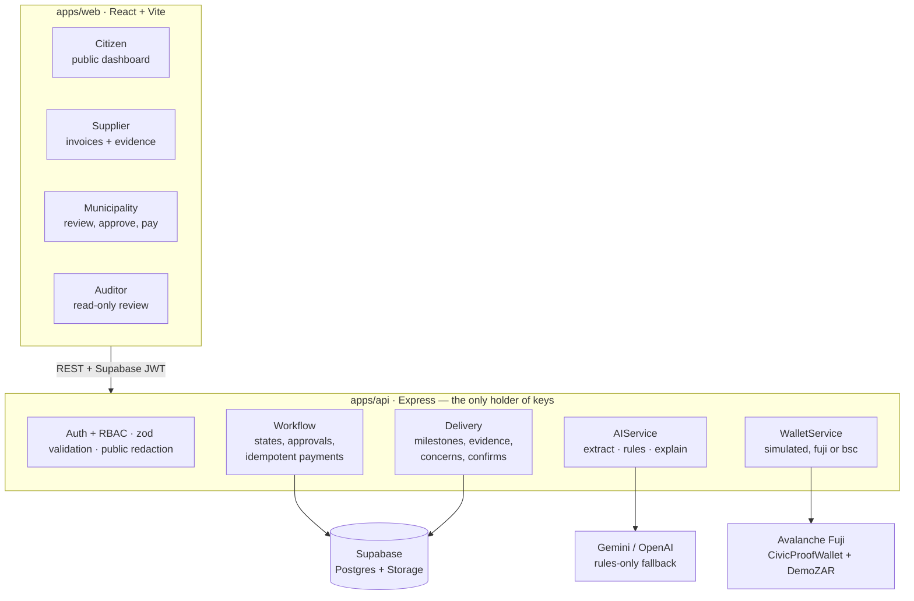
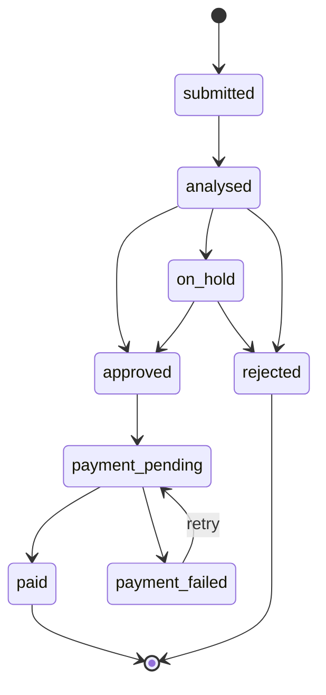

# CivicProof

> **Follow the money. Prove the service.**

CivicProof is a public-spending accountability platform built for the **BACISS 2026 hackathon**. It ring-fences a municipal project's budget in a dedicated wallet on a blockchain. An AI pipeline screens every supplier invoice before any money leaves, an authorised human decides, and every payment, hold and rejection is recorded where citizens can see it.

> ⚠️ **Simulated funds only.** Every project, supplier, price and amount in this repository is fictional. **DemoZAR (dZAR)** is a labelled test token on the Avalanche Fuji **testnet**. It is not real, backed or redeemable currency.

---

## Table of contents

- [The problem](#the-problem)
- [What CivicProof does](#what-civicproof-does)
- [The golden path (demo)](#the-golden-path-demo)
- [Architecture](#architecture)
- [Tech stack](#tech-stack)
- [Repository layout](#repository-layout)
- [Getting started](#getting-started)
- [Environment variables](#environment-variables)
- [Shared contracts](#shared-contracts)
- [AI expenditure review](#ai-expenditure-review)
- [Wallet and smart contract](#wallet-and-smart-contract)
- [API reference](#api-reference)
- [Demo data](#demo-data)
- [Team and ownership](#team-and-ownership)
- [Build timeline and gates](#build-timeline-and-gates)
- [Git workflow](#git-workflow)
- [Risks and fallbacks](#risks-and-fallbacks)
- [Scope, limitations and roadmap](#scope-limitations-and-roadmap)

---

## The problem

Municipal infrastructure money often disappears between the budget and the community. Invoices get inflated, suppliers appear weeks before winning work, purchases don't match the project's purpose, and paid-for services are never delivered. By the time an audit finds it, the money is gone.

Citizens can't see where the money went. Officials have no fast, consistent way to check an invoice before it is paid.

## What CivicProof does

| Module | What it gives you |
| --- | --- |
| **Ring-fenced project wallet** | Each project's budget sits in its own smart-contract wallet. Money only leaves through an authorised, recorded release. |
| **AI expenditure review** | Every invoice is extracted, checked against reference prices, the project's permitted purposes, the budget and the supplier registry, then explained in plain language. |
| **Human-in-the-loop approval** | **AI recommends; authorised humans decide.** Approving against an AI flag needs a written reason, which is recorded. |
| **Public transparency dashboard** | Citizens see budget, spent, balance, every payment with its transaction hash, and every held or rejected invoice, with personal data redacted. |
| **Delivery verification** *(extension)* | Milestones, photo evidence with duplicate detection, community confirmation and official verification. Delivery-dependent payments stay locked until the milestone is verified. |

### Core principles

1. **Every disbursement passes through the project wallet.** There is no side door.
2. **Rules decide, AI explains.** Flags come from deterministic code. The LLM extracts data and writes the explanation. We never label a supplier fraudulent on AI output alone.
3. **The chain proves integrity, not truth.** A document hash shows that evidence hasn't been altered since it was submitted. It doesn't prove the evidence was true. That's why humans review it.
4. **Community confirmation is evidence, not authorisation.** Citizens can confirm delivery, but only authorised officials can release money.

---

## The golden path (demo)

One fictional project, four invoices, one money trail that never breaks:

```
R2,000,000 project ──► 3 invoices ──► AI flags ──► human decision ──► on-chain payment ──► public dashboard
```

1. **Citizen view.** Project *CP001 Kgotso Valley Water Access* shows R2,000,000.00 allocated and nothing spent yet.
2. **Fair invoice.** 8 water tanks, no flags → approve → execute → *pending → confirmed* with a Snowtrace link.
3. **Inflated invoice.** 20 pipes at R12,000.00 each against a R5,200.00 benchmark gives **R136,000.00 potential excess**. The supplier is also only 21 days old. **Hold**: the money stays in the wallet.
4. **Wrong purpose.** A R785,000.00 double-cab bakkie on a water project is a `PURPOSE_MISMATCH`, so it's **rejected**, and the rejection is recorded on-chain.
5. **Prove the service** *(if the delivery module ships)*. The installation invoice is approved, but its payment is blocked until milestone M1 is verified. A re-uploaded photo is flagged as `DUPLICATE_EVIDENCE`. After community confirmations and official verification, the payment goes through.
6. **Close.** The balance is **R1,817,600.00**, every payment shows its hash, and held and rejected invoices are publicly visible.

---

## Architecture

A **modular monolith** with blockchain integration: one React app, one Express API, one Supabase project and one smart contract.



**The browser only ever talks to the API.** The frontend never touches the database or the chain directly. Switching from the simulated ledger to Fuji, or from the LLM to rules-only mode, is one environment variable and no code changes.

### Where data lives

| On-chain (authority for money) | Supabase (application data) |
| --- | --- |
| Project ID, allocation, wallet balance | Project descriptions, users and roles |
| Payment amount, supplier wallet address | Supplier details, invoices, line items |
| Invoice document hash, approval events | AI findings, reference prices, documents |
| Transaction history and status | Delivery photos, milestones, verifications, concerns |

Confirmed chain events are synced to the database, and balances are reconciled before redacted public records are shown.

---

## Tech stack

| Layer | Choice | Notes |
| --- | --- | --- |
| Frontend | React + Vite + Tailwind, React Router, TanStack Query | Recharts for the dashboard; shadcn/ui optional |
| Backend | Node 20 + Express + TypeScript, zod | Shares types with the web app through `packages/shared` |
| Database & files | Supabase Postgres + Storage (`invoices`, `evidence` buckets) | RLS on, no policies: only the API's service-role key reads or writes |
| Auth | Supabase Auth, 4 seeded demo users | API verifies the JWT, then reads `role` from `users` |
| AI | Gemini Flash-tier (JSON output, PDF input); OpenAI as backup | Wrapped in `AIService`; `AI_MODE=llm\|rules` |
| Chain | Solidity 0.8.24 + OpenZeppelin 5, Hardhat, ethers v6 | Avalanche Fuji C-Chain, chain ID **43113** |
| Hosting | Web on Vercel, API on Northflank (Render as backup) | `main` auto-deploys |

---

## Repository layout

One repo, npm workspaces. **Owning a folder means you merge into it; anyone else opens a PR.**

```
civic_proof/
├── apps/
│   ├── web/                      P1  React app (pages/delivery/* → P5, components/ai/* → P4)
│   └── api/                      P2  Express API
│       └── src/
│           ├── services/ai/      P4  extract.ts, rules.ts, explain.ts
│           ├── services/wallet/  P3  WalletService.ts, simulated.ts, fuji.ts
│           └── routes/delivery.ts P5
├── contracts/                    P3  Hardhat project, CivicProof.sol
├── packages/
│   └── shared/                   P2  types.ts, enums.ts, abi/ (P3 drops ABIs here)
├── supabase/                     P2  schema.sql, seed.sql (P5 writes the data)
└── docs/
    └── demo-script.md            P5
```

---

## Getting started

### Prerequisites

- Node.js 20+ and npm 10+
- A Supabase project (URL, anon key, service-role key)
- A Gemini API key (OpenAI optional, as backup)
- *For on-chain mode:* a deployer wallet funded with Fuji test AVAX

### 1. Install

```bash
git clone https://github.com/Wityd/civic_proof.git
```

```bash
cd civic_proof && npm install
```

### 2. Configure

```bash
cp .env.example .env
```

Fill in the keys (see [Environment variables](#environment-variables)). **Never commit `.env`.** Team keys are shared in the private team channel only.

### 3. Database

Run `supabase/schema.sql`, then `supabase/seed.sql`, in the Supabase SQL editor. Create the four demo users (citizen, supplier, municipality, auditor) in Supabase Auth.

### 4. Run locally

```bash
npm run dev
```

This starts the web app and the API together. To work on the frontend before the API is ready, set `VITE_USE_MOCKS=true` and the app will serve `mocks/*.json`.

### 5. Contracts *(P3)*

```bash
cd contracts && npx hardhat test
```

```bash
npx hardhat run scripts/deploy.ts --network fuji
```

The deploy script deploys `DemoZAR` and `CivicProofWallet`, mints R2,000,000.00 dZAR, creates CP001 and funds it. Then copy both addresses into `.env` and the ABIs into `packages/shared/abi/`.

### 6. Reset the demo

```bash
npm run demo:reset
```

This wipes and reseeds the demo data. Run it before every rehearsal.

---

## Environment variables

```bash
# ── api ───────────────────────────────────────────────
SUPABASE_URL=
SUPABASE_SERVICE_ROLE_KEY=
GEMINI_API_KEY=
OPENAI_API_KEY=
AI_MODE=llm                     # llm | rules
WALLET_MODE=simulated           # simulated | fuji | bsc
FUJI_RPC_URL=https://api.avax-test.network/ext/bc/C/rpc
DEPLOYER_PRIVATE_KEY=
DEMOZAR_ADDRESS=
FACTORY_ADDRESS=                # factory for the selected chain
BSC_TESTNET_RPC_URL=https://data-seed-prebsc-1-s1.bnbchain.org:8545
DEMO_RESET_KEY=

# ── web ───────────────────────────────────────────────
VITE_API_URL=
VITE_SUPABASE_URL=
VITE_SUPABASE_ANON_KEY=
VITE_USE_MOCKS=true
```

> 🔐 **Keys stay server-side.** Only `VITE_*` variables reach the browser, and none of them are secrets.

---

## Shared contracts

These agreements let five people build in parallel. They were frozen at **T+1:00**, and any change must be approved by P2 and announced to the team.

### Conventions

- **Money is integer cents everywhere.** Use `bigint` in the DB and fields ending in `_cents` in JSON. On-chain, dZAR has 2 decimals, so 1 token unit = 1 cent. Never use floats for money.
- **IDs are UUIDs.** Human-readable codes look like `CP001`. On-chain keys are `keccak256(uuid)`.
- **Response envelope:** `{ "data": ... }` or `{ "error": { "code", "message" } }`. The API uses status codes 400, 401, 403, 404 and 409 (`INVALID_STATE`, `ALREADY_PAID`).
- **Public endpoints never return** supplier contact details, user emails or raw AI prompts.
- **Invoice numbers are deliberately not unique** in the DB, so the rules engine can flag duplicates.

### Invoice state machine



Any other transition returns `409 INVALID_STATE`. A user can't approve an invoice they submitted.

### When the chain is touched

| App action | Contract call |
| --- | --- |
| Submit invoice | `submitPaymentRequest` (anchors the document hash immediately) |
| Approve | `approvePayment` |
| Reject | `rejectPayment` |
| Hold | *no chain call* |
| Execute payment | `releasePayment` |
| Official milestone verification | `verifyMilestone` |

---

## AI expenditure review

```
Upload ──► Extract ──► Retrieve ──► Validate ──► Assess ──► Human review
 PDF /      LLM →       reference    rules.ts     LLM writes  approve /
 manual     JSON        prices,      (flags)      2–4 plain   hold /
                        registry                  sentences   reject
```

- **Extract:** the LLM returns zod-validated `InvoiceExtraction` JSON. The reference catalogue is included in the prompt so the model can pick a `reference_sku` for each line.
- **Validate:** `rules.ts` raises every flag. This is deterministic, repeatable and testable.
- **Explain:** the LLM summarises the rule output only and adds **no new numbers**.
- **Cached by document SHA-256**, so the demo gives the same answer every time.
- **`AI_MODE=rules`** is a full fallback that uses template explanations and needs no LLM.

### Flag codes

| Code | Severity | Fires when |
| --- | --- | --- |
| `PURPOSE_MISMATCH` | high | A line's category isn't in the project's `permitted_categories` |
| `PRICE_ABOVE_BENCHMARK` | high | Unit price is more than **15%** above the reference price |
| `DUPLICATE_INVOICE` | high | Same supplier and invoice number, or the same document SHA-256, already exists |
| `ARITHMETIC_MISMATCH` | high | qty × unit ≠ line total, or the lines ≠ the invoice total (1-cent tolerance) |
| `BUDGET_EXCEEDED` | high | The total is more than the wallet's available balance |
| `SUPPLIER_REVIEW_REQUIRED` | medium | The supplier registered fewer than 90 days before the invoice date, or is unverified |
| `NO_BENCHMARK` | info | No reference price matched a line |
| `DUPLICATE_EVIDENCE` | high | A delivery photo's SHA-256 matches earlier evidence |

**Recommendation:** any `PURPOSE_MISMATCH` → `REJECT`. Any other high or medium flag → `HOLD_FOR_REVIEW`. Otherwise → `APPROVE`. Approving against a flag requires a written reason and sets `overrode_ai = true`.

<details>
<summary>Example <code>POST /invoices/:id/analyse</code> response (inflated pipe invoice)</summary>

```json
{
  "extraction": {
    "supplier_name": "Pipeworks Direct CC",
    "registration_no": "2026/771204/23",
    "invoice_number": "PD-0147",
    "invoice_date": "2026-11-18",
    "line_items": [
      {
        "description": "250mm HDPE pipe 12m",
        "category": "pipes",
        "reference_sku": "PIPE-HDPE-250-12",
        "quantity": 20,
        "unit_price_cents": 1200000,
        "line_total_cents": 24000000
      }
    ],
    "total_cents": 24000000,
    "confidence": 0.93
  },
  "checks": [
    { "code": "PRICE_ABOVE_BENCHMARK", "severity": "high", "line": 0,
      "detail": "R12,000.00 per unit vs benchmark R5,200.00 (+131%)" },
    { "code": "SUPPLIER_REVIEW_REQUIRED", "severity": "medium",
      "detail": "Supplier registered 21 days before invoice date" }
  ],
  "flags": ["PRICE_ABOVE_BENCHMARK", "SUPPLIER_REVIEW_REQUIRED"],
  "benchmarks": [
    { "line": 0, "sku": "PIPE-HDPE-250-12",
      "benchmark_unit_cents": 520000, "invoice_unit_cents": 1200000,
      "benchmark_total_cents": 10400000, "excess_cents": 13600000,
      "source": "Seeded fictional demo data" }
  ],
  "potential_excess_cents": 13600000,
  "recommendation": "HOLD_FOR_REVIEW",
  "explanation": "Plain-language summary written by the LLM from the checks above only.",
  "mode": "llm"
}
```

</details>

---

## Wallet and smart contract

`contracts/contracts/` contains three contracts:

- **`DemoZAR`**: a clearly labelled ERC-20 test token with 2 decimals.
- **`CivicProofFactory`**: deploys a separate wallet for each project.
- **`ProjectWallet`**: ring-fences one project's funds, with municipality and approver roles.

The same contracts support Avalanche Fuji and BNB testnet; the API uses one at a
time. Per-project addresses belong in `project_wallets(project_id, mode,
wallet_address)`. See [P2/P3 integration](docs/P3-INTEGRATION.md) for the IDs,
configuration and updated shared types.

| Function | Role | Guard |
| --- | --- | --- |
| `createProject(projectId, allocated)` | MUNICIPALITY | Not already created; allocation > 0 |
| `fundProject(amount)` on ProjectWallet | MUNICIPALITY | Can't fund beyond the allocation; caller approves dZAR first |
| `submitPaymentRequest(requestId, supplier, amount, invoiceHash, milestoneId)` on ProjectWallet | MUNICIPALITY | One request per invoice; a linked milestone must already be registered |
| `approvePayment(requestId)` | APPROVER | Must be pending; amount ≤ balance minus already-approved amounts |
| `rejectPayment(requestId)` | APPROVER | Must be pending |
| `registerMilestone(milestoneId)` | MUNICIPALITY | Registers milestone before a dependent invoice can be submitted |
| `verifyMilestone(milestoneId)` | APPROVER | Records official verification |
| `releasePayment(requestId)` | APPROVER | Must be approved; any linked milestone must be verified; status flips **before** the transfer, so it pays once |
| `getBalance()` on ProjectWallet | view | Balance and available funds (balance minus approved-but-unpaid) |
| `getTransaction(requestId)` | view | The full request with its status |

**Safety tests (Hardhat):** a double release reverts, an outsider's approval reverts, overspending reverts, a release before milestone verification reverts, and the full flow ends at R1,817,600.00.

### One wallet interface, three modes

```ts
export type TxStatus = 'pending' | 'confirmed' | 'failed';
export interface TxResult {
  mode: 'simulated' | 'fuji' | 'bsc'; txHash: string; status: TxStatus;
  blockNumber?: number; error?: string;
}

export interface WalletService {
  createProject(projectId: string, allocatedCents: bigint): Promise<TxResult>;
  fundProject(projectId: string, amountCents: bigint): Promise<TxResult>;
  registerMilestone(milestoneId: string): Promise<TxResult>;
  submitPaymentRequest(invoiceId: string, projectId: string, supplierAddress: string,
                       amountCents: bigint, documentSha256: string,
                       milestoneId?: string): Promise<TxResult>;
  approvePayment(invoiceId: string): Promise<TxResult>;
  rejectPayment(invoiceId: string): Promise<TxResult>;
  verifyMilestone(milestoneId: string): Promise<TxResult>;
  releasePayment(invoiceId: string): Promise<TxResult>;
  getBalance(projectId: string): Promise<{ balanceCents: bigint; availableCents: bigint }>;
}
```

- **`SimulatedWalletService`** is backed by the database and applies the same rules as the contract. Its `tx_hash` is `sim_<uuid>` and it confirms instantly. In the UI it is always labelled **"Simulated ledger"**.
- **Chain wallet adapters** use ethers v6 and keys = `keccak256(toUtf8Bytes(uuid))`.
  They resolve the project's wallet on the configured chain, wait for confirmation
  and map reverts to API errors. Milestone registration precedes linked invoices;
  hold stays off-chain. Runtime adapters remain P3/P2 integration work.

### Network

| Setting | Value |
| --- | --- |
| Network | Avalanche Fuji C-Chain |
| Alternate network | BNB Smart Chain testnet, chain ID `97`, explorer [testnet.bscscan.com](https://testnet.bscscan.com) |
| Chain ID | `43113` |
| RPC | `https://api.avax-test.network/ext/bc/C/rpc` |
| Gas | Test AVAX |
| Explorer | [testnet.snowtrace.io](https://testnet.snowtrace.io) |
| Docs | [build.avax.network/docs/primary-network](https://build.avax.network/docs/primary-network) |

> **Honest note:** in this MVP the API server signs every transaction. The on-chain roles prove that **the rules** were followed, not **who clicked**. In production, each approver would sign with their own key or through a multisig.

Payment execution is **idempotent**. The API tracks `pending`, `confirmed` and `failed` transactions and never reports success before confirmation.

---

## API reference

All mutations require authentication, a role check and zod validation. Public reads return only approved, redacted data.

| Method | Endpoint | Who | Does |
| --- | --- | --- | --- |
| GET | `/me` | signed in | User and role |
| GET | `/projects` | public | Projects with budget, paid and balance |
| GET | `/projects/:id` | public | Project, milestones, redacted invoices |
| POST | `/projects` | municipality | Create the project; chain create + fund |
| GET | `/projects/:id/wallet` | public | `balance_cents`, `available_cents`, mode, contract address |
| GET | `/projects/:id/transactions` | public | Ledger / chain events, newest first |
| POST | `/suppliers` | municipality | Register a supplier |
| GET | `/suppliers/:id` | public | Redacted supplier profile |
| POST | `/invoices` | supplier | Multipart PDF + JSON; stores the hash; registers the request |
| GET | `/invoices?status=&project_id=` | municipality, auditor; supplier sees own | Review queue |
| GET | `/invoices/:id` | municipality, auditor, owning supplier | Items, AI review, approvals, transactions |
| POST | `/invoices/:id/analyse` | municipality | Run AI → `analysed` |
| POST | `/invoices/:id/approve` | municipality, not the submitter | `{ reason }` required if flagged |
| POST | `/invoices/:id/hold` | municipality | `{ reason }` |
| POST | `/invoices/:id/reject` | municipality | `{ reason }` |
| POST | `/payments/:invoiceId/execute` | municipality | Idempotent release; returns the existing release if one is live |
| POST | `/milestones/:id/evidence` | supplier, citizen | Photo upload + SHA-256 duplicate check |
| POST | `/milestones/:id/confirm` | citizen | Community confirmation (evidence, not authorisation) |
| POST | `/milestones/:id/verify` | municipality, auditor | Official verification → `verified` + chain |
| POST | `/projects/:id/concerns` | citizen | Raise a concern |
| POST | `/concerns/:id/respond` | municipality | Public response |
| POST | `/demo/reset` | needs `DEMO_RESET_KEY` | Wipe and reseed |

### Data model

14 tables: `projects`, `project_wallets`, `suppliers`, `milestones`, `invoices`, `invoice_items`, `ai_reviews`, `approvals`, `transactions`, `evidence`, `verifications`, `concerns`, `users`, `reference_prices`. Project-scoped rows link to projects directly or through their parent; users, suppliers and reference prices are shared.

---

## Demo data

**Project CP001 · Kgotso Valley Water Access** has a budget of R2,000,000.00. Its permitted categories are water storage, pipes and installation. Milestone **M1** is *"8 tanks installed at 4 village sites"*.

**Reference prices (seeded, fictional):** 10,000 L tank R14,500.00 · 250 mm HDPE pipe (12 m) R5,200.00 · tank installation R7,500.00 per tank.

| # | Supplier | Invoice | Total | Expected flags | AI recommends | Human decision |
| --- | --- | --- | --- | --- | --- | --- |
| 1 | Blue Basin Tanks (Pty) Ltd, reg. 2015 | 8 × 10,000 L tank @ R14,800.00 (+2%) | R118,400.00 | none | APPROVE | Approve → pay |
| 2 | Pipeworks Direct CC, reg. 28 Oct 2026 | 20 × 250 mm pipe @ R12,000.00 | R240,000.00 | `PRICE_ABOVE_BENCHMARK` (excess R136,000.00), `SUPPLIER_REVIEW_REQUIRED` | HOLD_FOR_REVIEW | Hold, funds stay in the wallet |
| 3 | Summit Motors (Pty) Ltd | 1 × 4x4 double-cab bakkie | R785,000.00 | `PURPOSE_MISMATCH`, `NO_BENCHMARK` | REJECT | Reject, recorded on-chain |
| 4 | Blue Basin Tanks (Pty) Ltd | 8 × installation @ R8,000.00, linked to M1 | R64,000.00 | none | APPROVE | Approve; payment blocked until M1 is verified |
| 2b | Pipeworks Direct CC | Same PDF as #2, resubmitted | R240,000.00 | `DUPLICATE_INVOICE` | HOLD_FOR_REVIEW | Optional extra beat |

**Wallet:** R2,000,000.00 → **R1,881,600.00** after #1 → **R1,817,600.00** after #4. R1,025,000.00 in held or rejected invoices (#2 + #3) never leaves the wallet, including R136,000.00 of potential overpricing.

The full 3-minute script is in [`docs/demo-script.md`](docs/demo-script.md).

---

## Team and ownership

| | Role | Owns | Must be done by T+7:00 |
| --- | --- | --- | --- |
| **P1** | Frontend lead | `apps/web` shell, routing, all portal pages | Public dashboard, supplier invoice form, municipality review queue, payment button |
| **P2** | Backend + tech lead | `apps/api`, `supabase/`, `packages/shared`, merges to `main` | Auth + roles, every core endpoint, invoice state machine, idempotent payments, API deployed |
| **P3** | Blockchain + **project lead** | `contracts/`, `services/wallet` | Contract on Fuji, `FujiWalletService`, golden path on-chain |
| **P4** | AI | `services/ai`, `components/ai` | Extraction, rules engine, price matching, `/analyse`, AI findings card |
| **P5** | Product, delivery, demo | Seed data, `routes/delivery`, `pages/delivery`, pitch | Seed data + 4 demo invoice PDFs, pitch skeleton, QA at every gate |

P2 has the final say on technical calls, and P5 has the final say on scope and the demo. P3, as project lead, coordinates the gates and the check-ins.

---

## Build timeline and gates

| Gate | Time | Definition of done |
| --- | --- | --- |
| **G0** | T+1:00 | Repo live, schema applied, keys shared, shared contracts frozen |
| **G1** | T+4:00 | Web and API deployed; dashboard reads real projects; invoice submit works in simulated mode; `/analyse` returns the JSON shape; contract on Fuji |
| **G2** ⭐ | **T+7:00** | **Invoices #1–#3 run end to end from a clean reset; chain go / no-go decided** |
| **G3** | T+8:00 | Feature freeze: only the delivery module and polish from here |
| **G4** | T+10:30 | Code freeze: bug fixes only, after the team agrees |
| **Submit** | T+12:00 | Pitch rehearsed three times; backup video recorded |

**Golden path first.** Nobody starts extension work until G2 passes.

### Check-in format (post at every gate)

```
P# · Gate G1 (T+4:00)
Done:            what works now (link or screenshot)
Not done:        what slipped and how much is left
Blocked by:      person / thing
Contract change: any change to schema, API, AI JSON or wallet interface (P2 must approve)
Next 3 hours:    top 3 tasks
```

---

## Git workflow

- **One branch per task**, prefixed with your role: `p1/dashboard`, `p3/fuji-wallet`, `p4/rules-engine`.
- **Small PRs.** P2 merges to `main` at least every 90 minutes.
- **`main` must always deploy.**
- Commit `.env.example` only, **never `.env`** or private keys.
- Any change to the shared contracts (schema, API, AI JSON, wallet interface) goes through P2 and is announced to the team.

---

## Risks and fallbacks

Every risky piece has a switch we can flip in under a minute, and we rehearse each switch before we need it.

| Risk | Fallback | Owner | Decide by |
| --- | --- | --- | --- |
| No Fuji test AVAX, or a flaky RPC | Local Hardhat node, or `WALLET_MODE=simulated` with a visible "Simulated ledger" label; show the deployed contract and its tests | P3 | Faucet by T+1:00; go / no-go at T+7:00 |
| LLM slow, down or inconsistent | Cache by document hash; `AI_MODE=rules`; manual line-item entry | P4 | Any time |
| Integration pain at the end | Frozen contracts, mocks, merges every 90 min | P2 | Every gate |
| Auth eats hours | Seeded users + "View as" role switcher; no sign-up | P1, P2 | T+2:00 |
| Deploy fails at the end | Skeleton live at T+4:00, redeployed at each gate | P2 | T+4:00 |
| Demo data drifts | `demo:reset` before every rehearsal | P2, P5 | T+9:30 |
| Venue Wi-Fi drops | Backup recording at T+10:45; phone hotspot; local run | P5 | T+10:45 |
| Scope creep | Parking-lot list; freezes at T+8:00 and T+10:30 | P5 | Always |

---

## Scope, limitations and roadmap

**MVP scope (must ship):** project + wallet, supplier registry, invoice submission, AI screening, approve / hold / reject, payment execution, public dashboard.

**Should:** a real Avalanche Fuji contract behind the same wallet interface.

**Could (after G2):** milestones, evidence with duplicate-photo detection, community confirmation, concerns, delivery-gated payment.

**Deliberately excluded:** real government funds, national procurement (e.g. CSD / eTender) integration, custom AI model training, production legal compliance, real sign-up and email flows, notifications, multi-municipality admin, mobile app, handwriting OCR, microservices and Kubernetes.

**Roadmap beyond the hackathon:**

- Per-approver signing (individual keys or multisig) instead of a server signer
- Integration with real supplier registries and verified price data sources
- Conventional banking rails, with on-chain records kept as the audit trail
- Independent security audit of the contracts and API
- Physical verification partnerships (community monitors, geotagged evidence)
- Institutional pilots with municipalities and the Auditor-General's office

---

<p align="center">
  <b>CivicProof</b> · BACISS 2026 · Concept architecture, simulated funds<br/>
  <i>AI recommends. Authorised humans decide. Citizens can see it all.</i>
</p>
